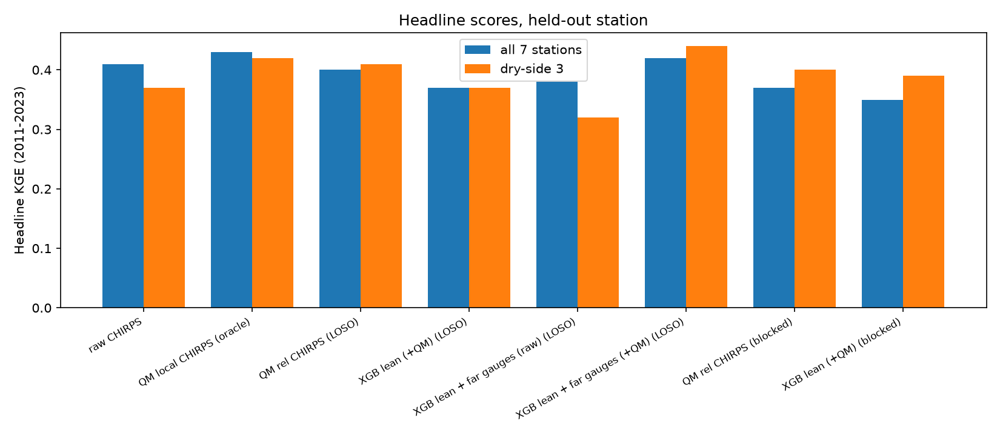
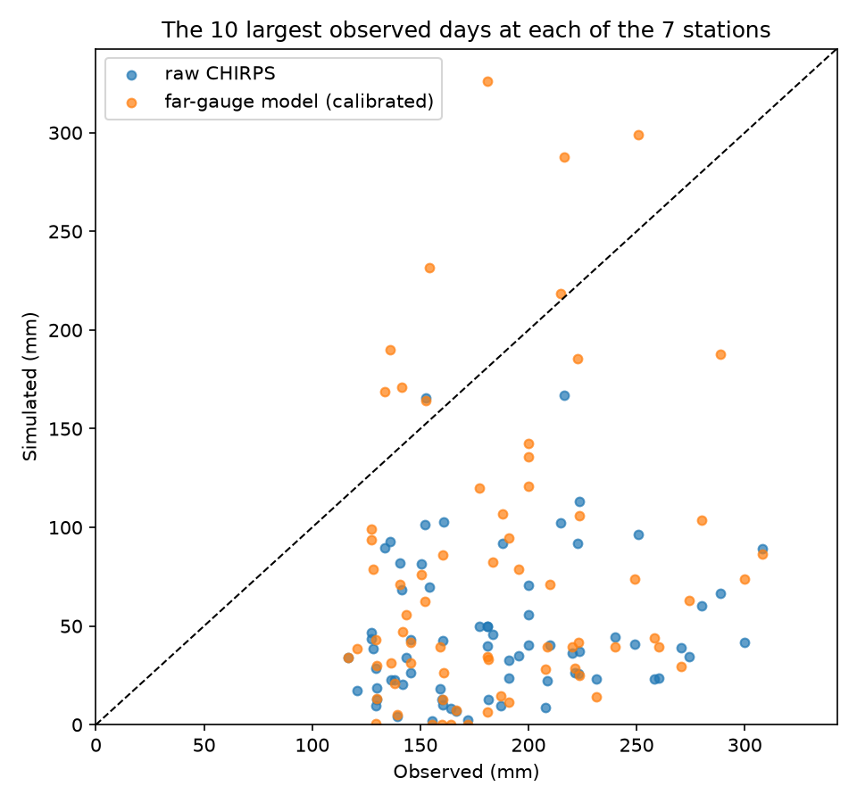
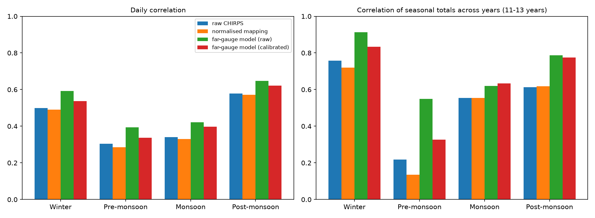
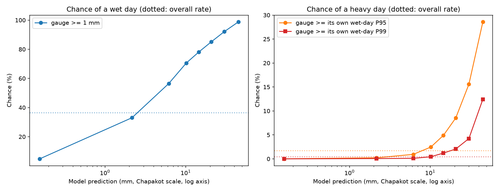
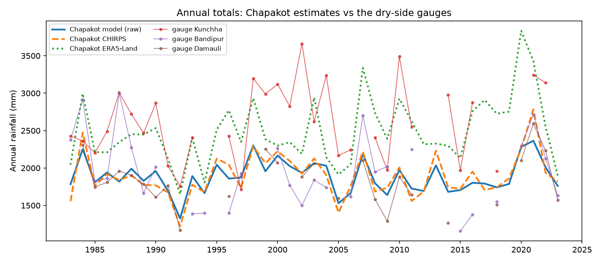
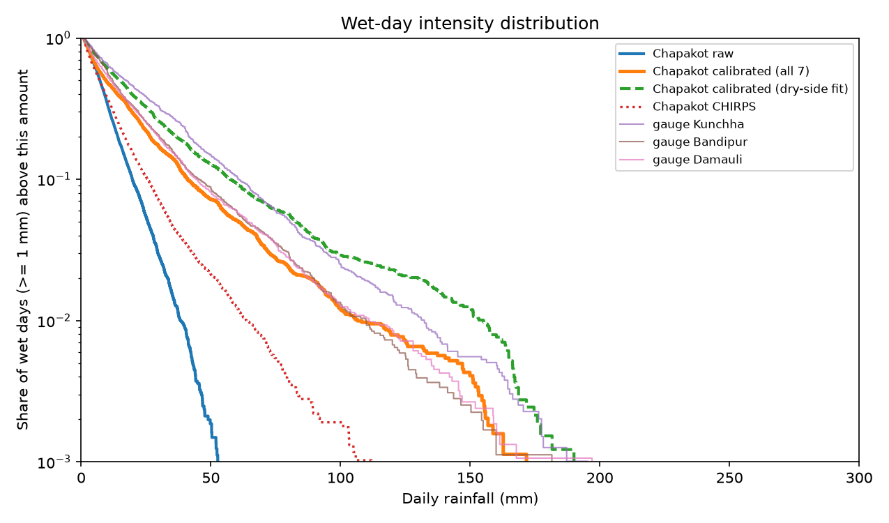

# Estimating daily rainfall at an ungauged site in central Nepal

Satellite rainfall, distant gauges and XGBoost, tested by leaving one gauge out at a time.

Status: model development finished, October 2026. This README is the project report.

## Summary

I have 40 years of daily rainfall (1983-2023) from seven gauges around Pokhara, Nepal. My home, Chapakot in Syangja district, has no gauge. This project asks whether satellite rainfall (CHIRPS), reanalysis weather (ERA5-Land) and the seven gauges can be combined with XGBoost into a daily rainfall series for a place like Chapakot, and how far that series can be trusted.

The answer is "partly". On gauges that were held out, the best model has a daily correlation of about 0.47 to 0.57 with the gauge, depending on the output, and a total-rainfall error of about 8 to 10 percent on average (up to 26 percent at one station). It does not clearly beat a simple bias correction of CHIRPS on Kling-Gupta efficiency (KGE). What it adds is a small but consistent gain in correlation, better ranking of heavy-rain days, and a rainfall distribution that matches the gauges once calibrated. The amounts on the heaviest days are still too low (median about 30 percent of the observed value), and the calibrated output spreads too wide at most stations.

I could not check anything at Chapakot itself. The long-term rainfall level there comes from CHIRPS (about 1,900 mm a year), and nothing built from these seven gauges can confirm it. Section 7 lists what the project cannot show.

## 1. Question

Given daily rainfall at seven stations 9 to 59 km apart, how well can I estimate daily rainfall at a site with no gauge?

The nearest gauge to Chapakot is Pokhara Airport, 39 km away. The others are 44 to 59 km away. At those distances, daily rainfall at one station says little about another (monsoon correlations between stations more than 33 km apart are 0.2 to 0.4), so the estimate has to rely mostly on satellite and reanalysis data. The gauges are used to correct them.

## 2. Data

### 2.1 Gauges

| Station | Index | District | Lat | Lon | Elevation (m) | Mean annual rain 1983-2010 (mm) |
|---|---|---|---|---|---|---|
| Pokhara Airport | 0804 | Kaski | 28.1886 | 84.0169 | 804 | 3928 |
| Kunchha | 0807 | Lamjung | 28.1268 | 84.3449 | 820 | 2620 |
| Bandipur | 0808 | Tanahun | 27.9418 | 84.4064 | 991 | 1939 |
| Lumle | 0814 | Kaski | 28.2965 | 83.8179 | 1738 | 5571 |
| Damauli | 0817 | Tanahun | 27.9737 | 84.2651 | 347 | 1892 |
| Sikles | 0824 | Kaski | 28.3559 | 84.1021 | 1967 | 3776 |
| Lamachaur | 0818 | Kaski | 28.2613 | 83.9683 | 991 | 4476 |
| Chapakot (no gauge) | | Syangja | 27.8855 | 83.8222 | 452 | |

Elevation does not explain the rainfall pattern. Lamachaur and Bandipur are both at 991 m and differ by a factor of 2.3 in annual rain. The stations fall into two groups: a wet group facing the Annapurna range (Pokhara Airport, Lumle, Sikles, Lamachaur) and a drier group to the south and east (Kunchha, Bandipur, Damauli). Satellite totals put Chapakot in the dry group, but that is an inference from the satellite data alone.

Gauge data: daily totals, one value per day, reported at 08:45 Nepal time (I treat the 03:00 UTC stamp in the files as that reading time). Source: [TODO: agency and how the data were obtained]. The data are not included in this repository [TODO: state the reason, for example redistribution limits].

### 2.2 Satellite and reanalysis data

- CHIRPS v3 daily, "rnl" version, 0.05 degrees (about 5.6 km), through Google Earth Engine (`UCSB-CHC/CHIRPS/V3/DAILY_RNL`). The daily values are pentad totals divided into days using ERA5 rainfall as the daily pattern, so CHIRPS is not an independent source of day-to-day information. CHIRPS also uses station observations, and I could not find out whether these seven gauges are among them. I used the "rnl" version because it covers the whole period (the other version relies on IMERG, which starts in 1998).
- ERA5-Land daily aggregates, about 11 km (`ECMWF/ERA5_LAND/DAILY_AGGR`), for temperature, humidity, wind, pressure and soil moisture. I did not use its rainfall in the final model (section 4.2).

Both were extracted at the pixel of each station and of Chapakot. CHIRPS was also extracted for the 3x3 block of pixels around each location.

### 2.3 Cleaning (notebook 00)

- Period: 1983-01-01 to 2023-12-31 (14,975 days), the years where all stations have data. Damauli's record starts on 1983-04-01.
- Lamachaur: the all-stations file had only 2023. I merged it with a separate, longer record. The two agree exactly on the 215 days they share. The earlier years (from 1973) are saved separately and are not used in the models. A block of zeros covering all of 1972 was removed.
- Zeros that are really missing data: several months at Kunchha, Bandipur and Damauli were recorded as dry while Pokhara Airport, Lumle and Sikles had 100 to 260 mm. I masked a month when the station's total was under 30 percent of its normal share of those three stations and at least 85 percent of its days were zero. Dry spells in the monsoon alone were not treated as errors, because these stations really are drier. Masked share of valid days: Bandipur 6.5 percent, Damauli 2.3, Kunchha 1.4, Lumle 0.2, Lamachaur 0.2, Pokhara Airport and Sikles 0. Two whole years of Bandipur (1998 and 2017, totals of 522 and 770 mm) were dropped. Around 85 percent of days have all seven stations present.
- Values below 0.1 mm appear only from 2020 at five stations, so I set them to zero. A wet day is a day with at least 1 mm.

### 2.4 A one-day date shift at Sikles

Sikles' record was one day early in two periods, 2005-01-01 to 2011-05-31 and 2020-02-01 to 2023-12-31, about 25 percent of the record. In those years the other gauges correlated best with Sikles' previous day, and CHIRPS agreed. After moving each value to the next day, the correlations returned to their normal level, while a placebo shift on Lumle made its correlations worse. I moved the values and set the first day of each period and the day after the first period to missing.

I do not know the cause. The boundaries were chosen on the same data used to check them, and the cross-checks that did not use the boundaries (CHIRPS and the Lumle placebo) both agree. Sikles is still the weakest station in most results.

## 3. Method

### 3.1 Features

The model must work at a site with no gauge history, so no feature can identify a station or use its own rainfall:

- **CHIRPS (9 features):** the day aligned to the gauge reading time (7/8 of the previous UTC day plus 1/8 of the day itself, chosen on correlation with the gauges), the raw previous, same and next day, the mean, maximum and spread of the 3x3 pixel block, rain the day before, and the 3-day sum.
- **ERA5-Land weather (10 features):** temperature, daily temperature range, humidity, dewpoint depression, wind (3 features), pressure and soil moisture, as anomalies from each location's own day-of-year average over 1983-2010, plus the daily pressure change. I used anomalies because the raw values identify the station. Sikles' 11 km pixel has a mean pressure of 673 hPa against 867 to 929 hPa elsewhere, and averages terrain much higher than the station (the pressure implies roughly 3,300 m against 1,967 m at the station).
- **Far gauges (5 features):** for the target location, rainfall at the training stations at least 30 km away: a weighted mean (1/distance squared) of their rain relative to each station's own average, the weighted fraction of them with at least 1 mm, their maximum, and the weighted mean on the previous and next day. No count of neighbours, because with six training stations it would identify them.
- **Tried and dropped:** ERA5-Land rainfall (no gain once CHIRPS is in), calendar day (no gain), latitude, longitude and elevation (they identify stations).

### 3.2 Normalisation

CHIRPS features, ERA5-Land rain features and the target are divided by the location's mean daily CHIRPS rainfall over 1983-2010, and predictions are multiplied back. The first model, without this, learned the rainfall level of its training stations. Trained on wet stations it overpredicted dry ones by 16 to 59 percent, and the reverse happened for wet stations. With normalisation, the mean absolute bias of the first model fell from 31 to 6 percent under 30 km blocking. The level now comes from CHIRPS, which is also why the long-term level at Chapakot is CHIRPS' level.

### 3.3 Model

XGBoost with a Tweedie loss (many days have no rain), depth 3, minimum child weight 100, learning rate 0.05, trained on the training stations in 1983-2005 with early stopping on 2006-2010 and then refitted on 1983-2010. A grid of 27 settings changed my skill score by only 0.009, so I kept a simple one.

Two outputs:

- **Raw:** the model output. Good for amounts and timing, but it smooths rainfall, calls too many days wet (about 54 percent of days at Chapakot against 26 to 27 percent at the dry gauges), and almost never reaches heavy-rain amounts.
- **Calibrated:** the same output passed through a quantile mapping fitted season by season on the 2006-2010 predictions of the training stations. Good for the rainfall distribution and for extremes, with the problems described in section 5.

### 3.4 Validation

- **Held-out station.** Each of the seven gauges is held out in turn. Two schemes: plain leave-one-station-out (LOSO), and a 30 km blocked version that also removes training stations within 30 km, to imitate Chapakot's isolation.
- **Held-out years.** Train on 1983-2010, test on 2011-2023. The headline score uses the held-out station in the test years.
- **Development set.** For choices made along the way I used the held-out station in 1983-2010 (trained on the other stations), so the headline years stayed untouched. That was not always the case, see section 8.
- Far-gauge features can only be built under plain LOSO. Under the 30 km block, no training station has a neighbour 30 km or more away.
- Scores: KGE (Gupta et al. 2009), daily and monthly correlation, percent bias, wet-day false alarms and hit rate, ratios of the 95th and 99th percentile days, annual maximum day, and detection of heavy days.

## 4. Results

### 4.1 Baselines and headline scores (2011-2023, held-out station, means over 7 stations)

| Method | KGE, 7 stations | KGE, dry-side 3 | Daily r | Monthly r | Mean abs. bias (%) | Wet-day false alarms | Hit rate, days above own P95 |
|---|---|---|---|---|---|---|---|
| Raw CHIRPS | 0.41 | 0.37 | 0.49 | 0.54 | 6 | 0.41 | 0.10 |
| Quantile mapping fitted on the station's own gauge (not possible at Chapakot) | 0.43 | 0.42 | 0.44 | 0.51 | 7 | 0.31 | 0.23 |
| Normalised quantile mapping of CHIRPS, no machine learning (LOSO) | 0.40 | 0.41 | 0.44 | 0.49 | 12 | 0.31 | 0.21 |
| XGBoost, satellite only, calibrated (LOSO) | 0.37 | 0.37 | 0.42 | 0.54 | 10 | 0.29 | 0.23 |
| XGBoost with far gauges, raw (LOSO) | 0.38 | 0.32 | 0.57 | 0.68 | 8 | 0.42 | 0.02 |
| XGBoost with far gauges, calibrated (LOSO) | 0.42 | 0.44 | 0.47 | 0.65 | 10 | 0.26 | 0.23 |
| Normalised quantile mapping (30 km blocked) | 0.37 | 0.40 | 0.43 | 0.49 | 13 | 0.30 | 0.21 |
| XGBoost, satellite only, calibrated (30 km blocked) | 0.35 | 0.39 | 0.43 | 0.53 | 9 | 0.27 | 0.23 |

"Dry-side 3" is Kunchha, Bandipur and Damauli, the stations most like Chapakot.



What the table shows:

1. **Normalising by each location's own satellite climatology mattered most.** It removed the rainfall-level bias that had made the first model worse than raw CHIRPS.
2. **The best calibrated model matches quantile mapping fitted on the station's own gauge** (KGE 0.42 against 0.43, and 0.44 against 0.42 on the dry side), without using any gauge at the target. This is under LOSO, the optimistic scheme.
3. **XGBoost adds little over normalised quantile mapping.** The far-gauge model leads by 0.022 KGE, with a 95 percent interval from resampling the 13 test years of [-0.027, 0.057]. Under the 30 km block, the satellite-only model is slightly worse than the mapping (0.35 against 0.37). These intervals only capture year-to-year sampling and not the fact that there are just seven stations.
4. **Far-gauge features add a small, steady gain:** +0.033 in daily correlation [0.024, 0.040] and +0.045 in KGE after calibration [0.022, 0.068] over the satellite-only model. The monthly correlation of 0.68 is not the model's doing, since a plain weighted average of the far gauges reaches the same value.
5. **Calibration trades correlation for distribution.** It fixes false alarms and the size of the heavy days but loses some correlation and adds bias to seasonal totals (section 4.3).

Other things I tested on the development set: a model with calendar only gets a daily correlation of 0.44, so the satellite adds about 0.1 on top of the seasonal cycle. ERA5-Land weather variables add 0.01 to 0.02 on correlations, which I cannot separate from noise with seven stations.

### 4.2 Heavy rain

Annual maximum day: the raw CHIRPS value is 69 percent of the observed one on average, the calibrated model's is 128 percent, but it falls on the right day (within 3 days) in only 17 to 19 percent of station-years for the far-gauge outputs (chance is about 5 percent) and 11 to 12 percent for CHIRPS and the mapping.

On the 10 largest observed days at each station (70 events):

| Output | Median simulated / observed | Reached at least half the observed amount | Reached the observed amount | Fell in the output's own top 5% of days |
|---|---|---|---|---|
| Raw CHIRPS | 0.19 | 13% | 1% | 46% (32 of 70) |
| Normalised mapping | 0.24 | 24% | 9% | 47% |
| Far-gauge model, raw | 0.18 | 1% | 0% | 61% |
| Far-gauge model, calibrated | 0.29 | 31% | 13% | 61% (43 of 70) |

The outputs are better at ranking heavy days than at their size: 61 percent of the largest observed days land in the model's own top 5 percent (chance is 5 percent). Of the model's top 5 percent days, about 15 percent reached the station's own 95th percentile for wet days, against a base rate of 1.7 percent, so about 85 percent of flagged days are not heavy. The gain over CHIRPS in ranking is concentrated at the wet-side stations. At the dry-side stations it is about 3 events out of 30.



### 4.3 Seasons

The model beats raw CHIRPS on daily correlation in all 28 station-season combinations, by 0.02 to 0.13. Skill is lowest in the pre-monsoon and monsoon (daily r about 0.4) and highest after the monsoon (about 0.65), where a few large October events dominate the correlation. Seasonal totals are biased by 15 to 35 percent outside the monsoon (monsoon: 6 to 10 percent). The calibrated output is the worst for pre-monsoon totals (33 percent bias at the stations, 38 percent at the dry-side three).



### 4.4 What a prediction of a given size means

Pooling the seven held-out stations (2011-2023), the mean raw prediction matches the mean gauge value in every size class. Two features matter for Chapakot. At the same predicted amount, the three dry-side stations are much less likely to record any rain than the others (for predictions of 4 to 8 mm, 37 percent against 71 percent for at least 1 mm). On the model's top 0.5 percent of days (161 days), 28.6 percent reached the station's own 95th percentile for wet days, and 12 percent the 99th. These are descriptive numbers from the same test years, not a new test. The table is in `outputs/reliability_table.csv`.



### 4.5 Chapakot

| Series | Mean annual rainfall 1983-2023 (mm) |
|---|---|
| CHIRPS, Chapakot pixel | 1895 |
| ERA5-Land | 2489 |
| Model, raw, all seven stations | 1888 (seven leave-one-out versions: 1782 to 1944) |
| Model, calibrated, all seven | 1908 (1665 to 2041) |
| Model, calibrated on the dry-side stations only | 1954 |

The model's level is CHIRPS' level by construction. At the three dry-side gauges, CHIRPS ran between 8 percent low and about even over the full record (Bandipur -8, Kunchha -3, Damauli 0), and the raw model's own total errors there were between -5 and +16 percent. If Chapakot behaves like them, the true level is plausibly 1,900 to 2,100 mm. That is a guess, not a result. ERA5-Land runs 26 to 62 percent too wet at four of the seven gauges, so I do not trust its 2,489 mm.

The seven leave-one-out versions correlate at 0.98 with each other, so their spread shows only how much removing one station matters. It understates the real uncertainty.





How I would use the output: the raw series for amounts and seasonal or monthly totals, with about plus or minus 15 percent on the annual total; the calibrated series for how often it rains, how heavy rain days are distributed, and extreme-value statistics, with the dry-side-fit version as an upper bound on heavy days (its largest day is 298 mm, above any dry-side gauge record of 200 to 223 mm). Individual days: neither.

## 5. Limits

- **No ground truth at Chapakot.** Everything above comes from holding out other stations. Chapakot is 39 to 59 km from all gauges. Plain LOSO leaves neighbours 9 to 23 km away (optimistic), and the 30 km block trains on only three or four stations from one climate group with no far-gauge features (pessimistic). Chapakot lies between the two, so I report both.
- **The rainfall level cannot be checked.** CHIRPS gives about 1,900 mm and ERA5-Land about 2,500 mm. A gauge at Chapakot is the only direct test.
- **Seven stations and 13 test years.** Differences of a few hundredths in KGE between methods are within the noise. Win counts across stations are small-sample statements.
- **Daily skill is low.** A given day at Chapakot is about as likely to be wrong as right. The monsoon daily correlation of CHIRPS and ERA5-Land with the gauges is only 0.3 to 0.4, and the model improves on that by about 0.1.
- **The calibrated output has too much spread.** On the headline test its spread is about 1.16 times the observed one on average (1.38 at Sikles), and the largest simulated day exceeds the station's record at six of seven stations. I tested whether a different scale for the calibration would fix this (four options) and none did. I do not know the cause. The calibrated series should not be used for design storms or return levels.
- **Heavy days are muted.** On the largest observed days the model reaches about 30 percent of the amount.
- **Gauge data quality.** The masking rule rests on three reference stations, so a real dry month at a drier station that is also zero at the references would be missed, and a masked month may occasionally have been real. The Sikles date shift was found with the same kind of cross-checking. Other stations could have similar problems that my tests are too weak to detect (Bandipur's correlations are low everywhere). Lamachaur's 2023 values cannot be checked against a second source.
- **Time alignment.** I assumed the gauge day ends at 03:00 UTC. The satellite day windows are approximate (CHIRPS' exact window was not verified), and the daily ERA5-Land aggregate cost about 0.02 in correlation against exact hourly windows.
- **CHIRPS and ERA5 share information.** Their monsoon daily correlation with each other is 0.61 to 0.66, more than either has with a gauge, so combining them gains little.
- **Pixel versus station.** The satellite pixels cover 5 to 11 km, and Sikles and Lumle sit in steep terrain where the pixel and the station differ in elevation. Lumle's CHIRPS total is 21 percent low.

## 6. What I would try next

1. A rain gauge at Chapakot through at least one monsoon, to test the level.
2. IMERG for 2001-2023, the only independent satellite rainfall source over most of the period. It would shorten the training record to about 23 years.
3. A two-stage model (wet or dry first, then the amount), aimed at the false alarms.
4. More gauges, including any nearer to Chapakot (I have not checked whether other stations exist in Syangja).

## 7. Choices made after seeing the test years

I changed course several times, and some of these changes were made while looking at the 2011-2023 scores:

- The first XGBoost run (raw features, no normalisation) scored below raw CHIRPS (KGE 0.28 against 0.41 under blocking). The cause was the rainfall level of the training stations, which led to normalisation. This was a response to the headline results.
- The first feature list, the normalisation and the calibration were decided after seeing the headline for the satellite-only model. Later choices (feature sets, hyperparameters, far-gauge features) were made on the development set only. The far-gauge model had never been scored on 2011-2023 before its final run, but the satellite-only model it is compared with had.
- Neighbour-gauge features could not be used under the 30 km block, so they were tested under LOSO only.
- The Sikles date shift was found when its results looked wrong, and was applied before the model comparisons in section 4.
- IMERG was not tried.

The headline numbers are therefore slightly optimistic.

## 8. Repository

```
rainfall_analysis/
  data/
    raw/          gauge files (not included)
    processed/    cleaned data, rules (not included)
    satellite/    extracted CHIRPS and ERA5-Land (not included)
  notebooks/
    00_data_cleaning
    01_eda_data_audit
    02_satellite_extraction
    03_feature_engineering
    04_baselines
    05_xgboost_model
    06_evaluation_extremes
  src/
    metrics.py        scoring functions
    splits.py         held-out station and blocked folds
    model_utils.py    data loading, training, calibration, scoring
    far_gauge.py      far-gauge features
  outputs/            scores, predictions, figures
  environment.yml
```

To rerun:

```
conda env create -f environment.yml
conda activate rainfall
python -m ipykernel install --user --name rainfall --display-name "Python (rainfall)"
```

Add your gauge CSVs to `data/raw/` (`all_stations.csv` with a `Time` column and one column per station, and `lamachaur_only.csv`), then run the notebooks in order. Notebook 02 needs an Earth Engine account and a Cloud project ID (set `EE_PROJECT` in it). Earth Engine registration and terms of use are the user's responsibility. The extraction takes about 3 minutes for CHIRPS and 11 minutes for ERA5-Land. The model notebooks run in minutes.

## 9. References and data credit

- Funk, C. et al. (2015). The climate hazards infrared precipitation with stations, a new environmental record for monitoring extremes. Scientific Data 2, 150066. For CHIRPS v3, cite the version given on its dataset page.
- Muñoz-Sabater, J. et al. (2021). ERA5-Land: a state-of-the-art global reanalysis dataset for land applications. Earth System Science Data 13, 4349-4383. Contains modified Copernicus Climate Change Service information.
- Gupta, H. V. et al. (2009). Decomposition of the mean squared error and NSE performance criteria: implications for improving hydrological modelling. Journal of Hydrology 377, 80-91.
- Chen, T. and Guestrin, C. (2016). XGBoost: a scalable tree boosting system. KDD 2016.

## 10. License

Code: MIT, see `LICENSE`. The gauge data are not covered by this license.

Biswash Kaphle, Syangja, Nepal. Corrections are welcome as GitHub issues.